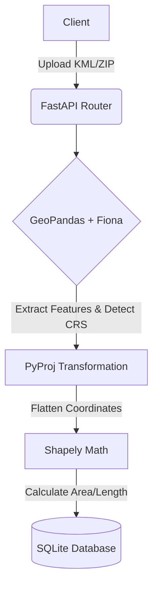

# Geospatial File Measurement API

A FastAPI-based backend service that accepts geospatial files (Shapefiles and KML), processes their geometric features, dynamically handles Coordinate Reference System (CRS) transformations, and calculates accurate physical measurements (Area and Length).

## 🚀 Setup & Installation

**1. Clone the repository and navigate to the project directory:**
```bash
git clone <your-repo-url>
cd geospatial-api
```

**2. Create and activate a virtual environment:**
```bash
python -m venv venv
source venv/bin/activate  # On Windows: venv\Scripts\activate
```

**3. Install dependencies:**
```bash
pip install fastapi uvicorn python-multipart sqlalchemy geopandas shapely fiona pyproj
```

**4. Run the application:**
```bash
uvicorn main:app --reload
```
Access the interactive API documentation at: `http://127.0.0.1:8000/docs`

---

## 📡 API Endpoints

### 1. Upload File
**POST** `/api/files/`
- **Accepts:** `.zip` (Shapefile) or `.kml` (Multipart form data).
- **Response:**
```json
{
  "id": "abc12345-6789-defg-hijk-lmnopqrs",
  "message": "File processed successfully"
}
```

### 2. Get File Information
**GET** `/api/files/{id}/`
- **Response:**
```json
{
  "id": "abc12345-6789-defg-hijk-lmnopqrs",
  "filename": "survey.kml",
  "feature_count": 1,
  "crs": "EPSG:4326",
  "status": "COMPLETED"
}
```

### 3. Get Measurements
**GET** `/api/files/{id}/measurements/`
- **Response:**
```json
[
  {
    "feature_index": 0,
    "geometry_type": "Polygon",
    "area_sqm": 12345.67,
    "length_m": null,
    "properties": {"name": "Zone A"}
  }
]
```

---

## 🏗️ Architecture & Design Decisions

- **Application Structure:** Built using **FastAPI** for high-performance asynchronous routing and **SQLAlchemy/SQLite** for lightweight, reliable data persistence without the overhead of PostGIS for this specific scope.
- **File-Processing Flow:** Files are temporarily saved to disk. **GeoPandas** combined with **Fiona** (with explicitly enabled KML OGR drivers) is used to read the binary/XML structures directly into a GeoDataFrame.
- **CRS Handling & Measurement:** Geographic coordinates (e.g., EPSG:4326 degrees) cannot be directly measured in meters. The API utilizes `gdf.estimate_utm_crs()` to dynamically calculate the local UTM zone based on the geometry's coordinates, ensuring highly accurate, survey-grade metric measurements for `.area` and `.length` using **Shapely**.

---

## 🧠 Learnings & Future Scope

### Key Learnings
1. **Proprietary Spatial Formats:** Learned how to utilize Virtual File Systems (`zip://`) to read Shapefiles directly from compressed archives without extracting them to disk.
2. **Coordinate Math:** Gained practical experience handling Earth's curvature by projecting coordinates into flat mathematical planes using `pyproj` before calculating area.
3. **Driver Management:** Discovered that modern Python GIS stacks often disable KML support by default, requiring manual OGR driver activation via Fiona.

### Future Scope (Step-by-Step Improvements)
1. **Implement Message Queues (Celery/RabbitMQ):** Offload file processing to background workers to prevent large multi-gigabyte Shapefiles from timing out the HTTP request.
2. **Migrate to PostGIS:** Replace SQLite with a PostgreSQL/PostGIS database to enable complex spatial querying (e.g., bounding box intersections).
3. **Cloud Storage Integration:** Modify the upload endpoint to stream files directly to AWS S3 rather than saving them to the local server's disk.

## Architecture Diagram


## 👨💻 Author

**Akshay Parimi**
* Software Engineer
* [GitHub](https://github.com/akshayparimi18) | [LinkedIn](https://www.linkedin.com/in/akshay-parimi) | [Email](mailto:parimiakshay7@gmail.com)
